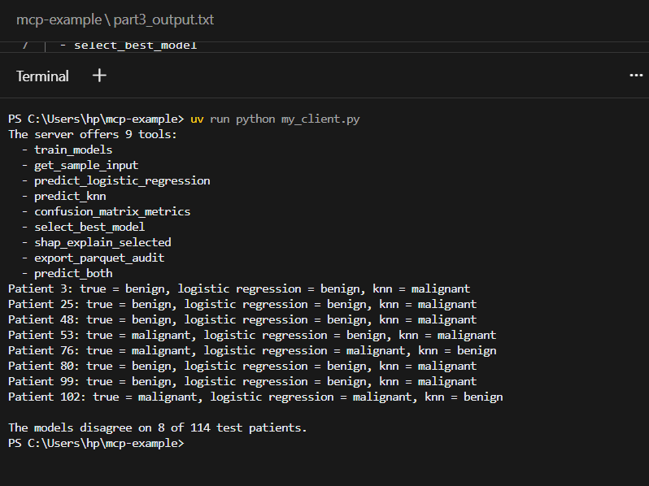

# MCP Assignment – Answers

## Part 3 terminal output

## 1. Tool count, and what changed in the client
- **Part 1:** the server listed **8 tools**.
- **Part 3:** the server listed **9 tools**. The new one is `predict_both`.
- **What I changed in the client:** nothing. I never registered `predict_both` in any client code. The client calls `list_tools()` (MCP's `tools/list`), and the server reports whatever tools it has. Once I added `predict_both` to the server with `@server.tool()`, the client found it on its own. MCP tools are discovered at runtime, not hard-coded.

## 2. Patients where the models disagree
The models disagree on **8 of 114** test patients:

| Patient | True class | Logistic Regression | KNN | Model that was right |
|---|---|---|---|---|
| 3   | benign    | benign    | malignant | Logistic Regression |
| 25  | benign    | benign    | malignant | Logistic Regression |
| 48  | benign    | benign    | malignant | Logistic Regression |
| 53  | malignant | benign    | malignant | **KNN** |
| 76  | malignant | malignant | benign    | Logistic Regression |
| 80  | benign    | benign    | malignant | Logistic Regression |
| 99  | benign    | benign    | malignant | Logistic Regression |
| 102 | malignant | malignant | benign    | Logistic Regression |

## 3. Which model was right more often when they disagreed?
**Logistic Regression**, which was right on **7 of 8** disagreements. KNN was right on only 1 (patient 53).
Most of KNN's mistakes were false alarms: it called benign patients malignant (5 cases). It also missed two real cancers (patients 76 and 102), which is the costlier mistake.

## 4. Why the triple-quoted description matters
The docstring becomes the tool's description in the MCP `tools/list` response. An AI app never sees the Python code. It only gets the tool's name, its input schema, and this description, and it uses them to decide **whether** to call the tool, **when** to call it, and **what** to pass in. A clear description ("predict with BOTH models in one call and report whether they agree") lets the AI pick `predict_both` when a user asks "do the models agree on this patient?". A vague or missing description could make the AI ignore the tool or misuse it.

## 5. Why the server logs every tool call
- **Accountability and auditing:** there is a record of who asked for what, when, and with what result. This matters most when an AI agent makes calls on its own, and in a medical setting.
- **Debugging:** if something goes wrong, the log shows which call failed and why (`status`, error), along with the `request_id` to trace it.
- **Reproducibility:** you can see exactly which predictions were made and check them again later.
- **Monitoring:** it shows how often each tool is used, how often calls fail, and whether an agent is behaving strangely (for example, calling a tool in a loop).

In Part 4 the log showed every `hw-sample-N` / `hw-both-N` call with `status = success`.

---

## Stretch goal: scaling the features for KNN
After wrapping KNN in `make_pipeline(StandardScaler(), KNeighborsClassifier(...))`:

- The models now disagree on **5 of 114** patients, down from 8:

| Patient | True class | Logistic Regression | KNN | Model that was right |
|---|---|---|---|---|
| 3  | benign    | benign    | malignant | Logistic Regression |
| 16 | benign    | malignant | benign    | **KNN** |
| 38 | benign    | benign    | malignant | Logistic Regression |
| 65 | malignant | benign    | malignant | **KNN** |
| 84 | malignant | malignant | benign    | Logistic Regression |

- **KNN got better.** Its test accuracy rose from **91.2% to 95.6%**, close to Logistic Regression's 96.5%. Without scaling, large features such as `mean area` (values over 1,000) dominated the distance calculation. After scaling, every feature counts equally.
